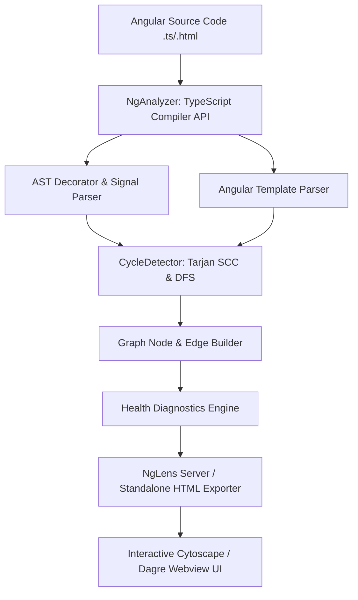

# 🅰️ NgLens (Super Angular)
### Interactive Visual Component & Signals Graph, Architecture Map & Health Auditor for Modern Angular Applications

[](https://www.npmjs.com/package/nglens)
[](https://angular.dev)
[](https://www.typescriptlang.org/)
[](https://www.npmjs.com/package/nglens)
[](LICENSE)

---

## 📦 Available on npm

**NgLens** is officially published and available on npm: **[https://www.npmjs.com/package/nglens](https://www.npmjs.com/package/nglens)**

You can run it instantly with **zero installation** via `npx`, or download/install it globally on your machine:

```bash
# ⚡ Option 1: Run instantly with zero installation (Recommended)
npx nglens

# 💻 Option 2: Download & install globally on your system
npm install -g nglens

# 🛠️ Option 3: Install as a project devDependency in your Angular repo
npm install --save-dev nglens
```

---

## 💡 The Pain Point

As Angular has rapidly evolved with **Standalone Components**, **Signals** (`signal()`, `computed()`, `model()`, `effect()`, `input()`, `output()`), and modern functional DI (`inject()`), large applications have become significantly more reactive—and harder to mentally map.

- Which components render which children?
- Where do Signals originate, and which computed values or templates consume them?
- Are there hidden **circular dependencies** waiting to cause runtime bugs?
- Which standalone components are **orphans/dead code** that nobody imports anymore?

**NgLens** solves this with a **1-click interactive visual architecture map and health auditor** built specifically for Angular.

---

## ✨ Features

- 🌳 **Interactive Component Hierarchy**: Visual Dagre-powered tree tracing `Parent ➔ Child` relationships from root to leaf components.
- ⚡ **Full Angular Signals Support**: Understands modern reactivity—`signal()`, `computed()`, `model()`, `effect()`, `toSignal()`, `toObservable()`, and signal-based `input()` / `output()`.
- 💉 **Dependency Injection Mapping**: See service providers and consumers across modern `inject()` calls and classic constructor parameters.
- 🩺 **1-Click Architecture Health Auditor**:
  - **Circular Dependency Detection**: Identifies exact cyclic loops (e.g. `CompA ➔ CompB ➔ CompA`) using Tarjan's SCC and DFS graph analysis.
  - **Dead Code / Orphan Component Detection**: Highlights unused standalone components never rendered or imported.
  - **Missing Standalone Imports**: Flags template tags used without matching component imports.
  - **Signal Adoption Rate**: Real-time gauge of modern signals vs classic mutable state.
- 🔍 **Live Inspector Drawer**: Click any node to inspect inputs, outputs, signals with reactive dependencies, injected tokens, and relative file paths.
- 📁 **Standalone Offline HTML Reports**: Export single-file, 100% self-contained offline reports (`nglens export`) with zero CDN or internet dependencies—perfect for PR reviews and CI artifacts.
- 🔌 **VS Code Extension Ready**: Run directly in VS Code side-by-side with your code, featuring 1-click **"Open in Editor"** navigation and live hot-reloading on save.

---

## 🚀 Quick Start

### 1. Test Drive with Demo (Zero Config)
Explore NgLens instantly with a realistic modern Angular 19 e-commerce store architecture:

```bash
npx nglens demo
```

### 2. Run in Any Angular Project
Navigate to your Angular project directory and run:

```bash
npx nglens
```
*NgLens will analyze your TypeScript AST, start a local server at `http://localhost:4242`, and automatically open the interactive studio in your browser!*

### 3. CI/CD Architecture Health Audit
Add an architecture quality gate to your GitHub Actions or GitLab CI:

```bash
npx nglens audit
```
*Exits with code `1` if circular dependencies or critical architectural errors are detected.*

### 4. Export Self-Contained Offline Report
Generate a single-file interactive HTML report to attach to Pull Requests or architecture reviews:

```bash
npx nglens export --output ./architecture-report.html
```

---

## 🛠️ CLI Options

```text
Usage: nglens [options] [command] [dir]

Arguments:
  dir                     Angular project directory to analyze (default: ".")

Options:
  -V, --version           output the version number
  -p, --port <number>     Port to run visualizer server on (default: "4242")
  --no-open               Do not automatically open browser
  -h, --help              display help for command

Commands:
  export [options] [dir]  Export self-contained offline HTML visualizer report
  audit [dir]             Run CI/CD architecture health check and exit with status code
  demo [options]          Explore NgLens with an interactive Angular 19 signals demo project
```

---

## 🏗️ Architecture & How It Works



1. **TypeScript Compiler API AST Parser**: Traverses class declarations, extracts `@Component` and `@Injectable` decorators, resolves standalone arrays, inputs, outputs, and reactive signal calls (`signal`, `computed`, `model`, `effect`, `input`, `output`, `inject`).
2. **Template Parser**: Scans HTML templates for custom child selectors, attribute/event bindings, and signal reads inside control flow `@if`, `@for`, and interpolations `{{ ... }}`.
3. **Graph & Cycle Detection Engine**: Builds a directed multi-edge graph and applies cycle detection to surface circular references and orphan nodes.
4. **Interactive Cytoscape UI**: Bundles Dagre hierarchical layout, search, filters, dark-mode design, and reactive node highlighting into a single 500 KB bundle.

---

## 🧩 VS Code Extension

To run NgLens inside VS Code:
1. Open your Angular project in VS Code.
2. Press `Ctrl+Shift+P` (or `Cmd+Shift+P` on macOS) and run `NgLens: Open Architecture & Signals Graph`.
3. The interactive webview opens side-by-side with your code editor.
4. Clicking **"Open in Editor"** on any component automatically jumps straight to that file and line!

---

## 🧪 Testing

NgLens has 100% passing automated test coverage across parser engines, cycle detectors, and template analyzers:

```bash
npm test
```

---

## 📄 License

MIT © Pratik
